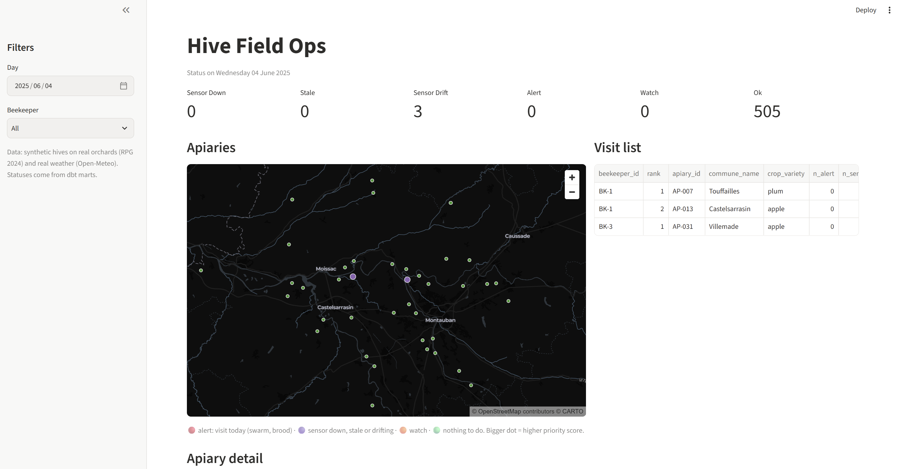
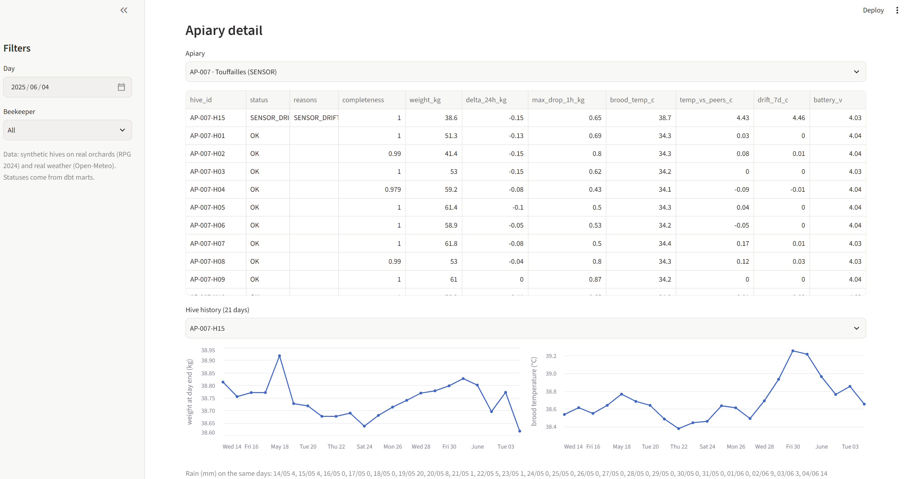
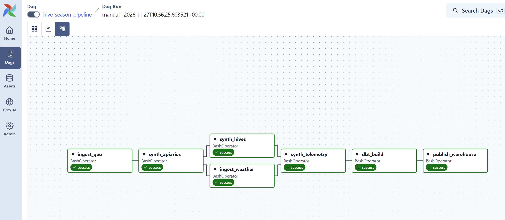
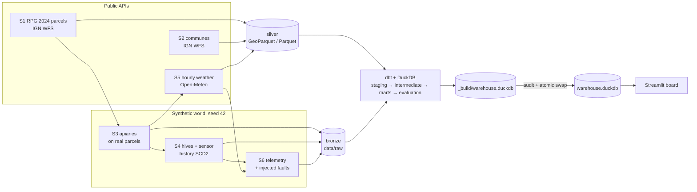

# hive-data-platform

A small, end-to-end data platform for a fictional ag-tech company that sells connected beehive
scales. It answers one business question for the field team, every morning:

> **Which apiary should each beekeeper visit first today, and why?**

Real public data (agricultural parcels, commune boundaries, hourly weather) is combined with a
synthetic fleet of hives and IoT sensors placed on top of it. Faults are injected into the
synthetic telemetry, so every alert rule can be **scored against ground truth**.

Region: Tarn-et-Garonne (dept 82), France · Season: 1 March – 31 October 2025 (Europe/Paris)




> The company is a composite built for this portfolio. It is not affiliated with any real company.
> Thresholds are calibrated on synthetic data and would need validation by a beekeeper.

## Run it

Needs Docker Desktop.

```bash
docker compose up -d --build
```

1. Open Airflow at http://localhost:8080 (local dev setup, no login).
2. Trigger `hive_season_pipeline`.
3. When it is green, the board at http://localhost:8501 shows the new warehouse.



Raw API responses are cached in `data/raw`, so reruns only call the APIs for what is missing.
`docker compose down` stops everything (`-v` also drops Airflow's metadata DB and logs).

## Architecture



Airflow runs the steps in this order (`dags/hive_season_pipeline.py`). Docker Compose runs
Postgres, the Airflow components (LocalExecutor) and the board from one image.

| Layer | What it holds | Guarantee |
|---|---|---|
| bronze `data/raw` | API responses, synthetic outputs | immutable cache, key includes every input that changes the content |
| silver `data/lake/silver` | cleaned parcels, communes, weather | validated before write, atomic writes |
| warehouse | dbt staging, intermediate, marts, evaluation | dbt tests pass before the file is published |

## Data

| Source | Kind | Volume |
|---|---|---|
| S1 RPG 2024 parcels | real, IGN WFS, 5 km tiles | 99,057 parcels |
| S2 communes | real, IGN WFS | dept 82 |
| S3 apiaries | synthetic, placed on kiwi / orchard parcels | 40 apiaries, 3 beekeepers |
| S4 hives and sensors | synthetic, SCD2 sensor history | 508 hives, 533 sensors, 25 swaps |
| S5 weather | real, Open-Meteo archive, hourly | 235,200 rows (40 apiaries × 5,880 h) |
| S6 telemetry | synthetic, 15 min, weight + brood temperature | 11.56 M rows, completeness 0.995 |

Injected faults (ground truth, used only by the evaluation models): DRIFT 15, DROPOUT 25,
SENSOR_SWAP 25, SWARM 25.

## Hive status rules

Each hive gets one status per local day. Priority:
`SENSOR_DOWN > STALE > SENSOR_DRIFT > ALERT > WATCH > OK`.
A broken sensor comes first because it makes every other rule unreliable.

- **SWARM_SUSPECTED (ALERT):** a 1 h weight drop above 1.2 kg. The largest healthy 1 h drop was
  1.03 kg and the smallest swarm was 1.41 kg.
- **BROOD_TEMP (ALERT):** brood colder than the apiary median by more than 1.5 °C, or unstable.
- **SENSOR_DRIFT:** the 7-day temperature is more than 3 °C off the apiary median.
- **SENSOR_DOWN / STALE:** low daily completeness, or no reading for more than 6 h at day end.
- **WATCH:** sharp drop, weight loss on a dry day, 7-day decline, low completeness.

Visit priority per apiary = 3 × alerts + 2 × sensor issues + 1 × watches. The score is then ranked
per beekeeper and day.

### Scored against the injected faults (`evaluation.eval_alert_rules`)

- False alert days: **0** for every rule.
- SENSOR_DRIFT detects 15 of 15 drifts, with a median delay of 19 days.
- SENSOR_DOWN detects 18 of 25 dropouts, and STALE detects 24 of 25. They complement each other:
  daily completeness misses short outages, and STALE catches them.

**What the evaluation changed:** the first brood temperature rule used an absolute 33–37 °C
range. It produced 216 false alerts from drifting sensors. Removing the upper bound still left
127, all on cold March days that every hive in the apiary shared. Comparing each hive with the
apiary median took the shared cause (weather) out and brought false alerts to 0.

## Design decisions

- **Profile before ingesting.** Notebooks 01–03 check what the APIs really return on small
  samples before the full run.
- **Fail loudly on data surprises.** One RPG parcel arrived split into a 6.44 ha body and a
  3 m² sliver. Identical duplicates are kept once, split records are unioned, and conflicting
  attributes stop the run.
- **Two CRSs.** EPSG:4326 for storage and APIs, EPSG:2154 (Lambert-93) for areas and spatial
  predicates.
- **UTC storage, local days.** DST days have 92 or 100 quarter-hour slots, and a dbt test checks
  it.
- **Time-based windows.** `RANGE ... interval 1 hour preceding` instead of a row count, so a
  missing reading does not stretch the window. A hive × day spine makes days with no data visible.
- **Point-in-time sensor join.** SCD2 with half-open intervals `[valid_from, valid_to)`.
- **The ground truth never feeds a mart.** A dbt test on the graph allows `fault_log` only in the
  evaluation models.
- **Warehouse write-audit-publish.** dbt builds into a separate file. The publish step checks the
  tables the board needs, then swaps the file in with one atomic rename. The board never reads a
  half-built warehouse.
- **Airflow only orchestrates.** Tasks call the same `python -m ...` commands used by hand, and
  data moves through the lake, not XCom. Only the public API steps retry. `max_active_runs=1`.
- **Two Python environments in one image.** The pipeline runs in its own virtualenv, so
  geopandas and dbt never clash with Airflow's pinned dependencies.

## Tests and CI

- **pytest:** fake worlds and sessions (always run), real API snapshots in `data/samples`, and
  `@pytest.mark.network` tests (skipped by default).
- **dbt tests:** uniqueness, status priority, DST slots, SCD2 join, and the ground-truth
  lineage guard.
- **Board:** query layer tests on a tiny warehouse, plus headless Streamlit `AppTest`.
- **DAG integrity:** imports, graph, retry policy, timeouts, and every module the DAG runs exists.
- **GitHub Actions:** `ci.yml` runs ruff and pytest in the conda env. `platform.yml` runs the DAG
  tests with Airflow and builds the Docker image.

## Develop without Docker

```bash
conda env create -f environment.yml && conda activate hive
pip install -e .
pytest -q

python -m hive_platform.ingest.geo               # S1 + S2
python -m hive_platform.synthetic.apiaries       # S3
python -m hive_platform.synthetic.hives          # S4
python -m hive_platform.ingest.weather           # S5
python -m hive_platform.synthetic.telemetry      # S6
cd dbt && dbt build && cd ..
streamlit run src/hive_platform/board/app.py
```

## Repository layout

```
src/hive_platform/
  common/       http session with retries, atomic writes, season definition
  ingest/       geo (S1, S2), weather (S5)
  synthetic/    apiaries (S3), hives (S4), telemetry (S6)
  ops/          warehouse publish
  board/        queries.py (SQL only) + app.py (Streamlit)
dbt/            staging, intermediate, marts/ops, evaluation, tests, macros
dags/           Airflow DAG
docker/         Dockerfile, pinned pipeline requirements
docs/           requirements (field_ops.md, source_mapping.md), images
notebooks/      source profiling 01–03
scripts/        one-off diagnostics (swarm threshold, brood alerts)
```

## Known limitations

- Hives per parcel do not scale with parcel area.
- Drifting sensors are never replaced in the simulation, so SENSOR_DRIFT lasts for the rest of the
  season (1,592 hive-days).
- Peer-relative rules need several hives per apiary.
- The daily SENSOR_DOWN rule misses short outages; STALE covers them.
- The Compose setup is for local development only: no login, fixed JWT secret.

## Roadmap (v1.x)

- Raster land cover (Corine) and NDVI around each apiary
- H3 hexagon aggregation
- Cloud deployment